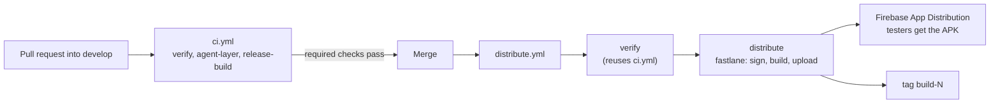

# CI/CD: test builds to Firebase App Distribution

Merging a pull request into `develop` runs the tests, builds a signed release APK and sends it to a Firebase App
Distribution tester group. Nothing is released to a store. The choices behind this are in
[ADR 7](decisions/0007-distribute-test-builds-with-fastlane-and-firebase.md).



## What runs when

| Event | Workflow | Jobs |
|---|---|---|
| Pull request (any branch) | `../.github/workflows/ci.yml` | `verify` (build, unit tests, lint, detekt, ktlint), `agent-layer`; plus `release-build` (unsigned `assembleRelease` with R8) for pull requests into `develop` |
| Push to `main` | `ci.yml` | `verify`, `agent-layer` |
| Push to `develop` (a merge), or manual run | `../.github/workflows/distribute.yml` | `verify` (the same jobs as `ci.yml`), then `distribute`, then `tag` |

The gate "tests must pass before a build" has two layers: branch protection on `develop` requires the CI checks before
a merge (a setting you enable once, see below), and `distribute.yml` runs `verify` again after the merge.

If `FIREBASE_APP_ID` is not set, `distribute` is skipped and the run is still green, so a fresh clone needs no Firebase
setup.

## Versioning

- `versionName` is a constant in `app/build.gradle.kts`. Bump it yourself on `develop`, for example `1.1.1`.
- `versionCode` is the Firebase build number and is automatic: `github.run_number` plus the optional repository
  variable `VERSION_CODE_OFFSET`. Locally it defaults to `1`. `run_number` is per workflow file, so renaming or
  recreating `distribute.yml` restarts it; set `VERSION_CODE_OFFSET` to the last number you used to continue the series.
- Each distributed commit gets a tag `build-<versionCode>`.

## Release notes

For now the notes are the commit subjects since the previous `build-*` tag (the last 10 commits on the first run), cut
to 4000 characters. A manual run can supply its own text. Squash-merging pull requests keeps the list to one line per
pull request, so use a clear pull request title. Notes written from the actual changes are a later step.

## One-time setup

1. **Branch.** Create `develop` from `main`. Protect it: require a pull request, require the status checks (shown as
   `verify / verify`, `agent-layer` and `release-build`; confirm the exact names after the first run), and require a
   review from Code Owners (`../.github/CODEOWNERS` covers the workflow, fastlane and Gradle files, because anyone who can
   push to `develop` could otherwise change the workflow and read the secrets).
2. **Firebase.** Create a project, register the Android app with your final applicationId (after the rename), enable
   App Distribution and create a tester group; note its alias.
3. **Service account.** In Google Cloud, create a service account with the Firebase App Distribution Admin role and
   download its JSON key.
4. **Signing key.** Create a keystore and keep a safe copy outside GitHub:
   ```bash
   keytool -genkeypair -v -keystore release.keystore -alias release -keyalg RSA -keysize 2048 -validity 10000
   base64 -i release.keystore | pbcopy
   ```
5. **GitHub Environment.** Create the environment `distribution`, limit its deployment branches to `develop`, and add
   the secrets below.
6. **Repository variables.** Add `FIREBASE_APP_ID` and `FIREBASE_TESTER_GROUPS` (and optionally `VERSION_CODE_OFFSET`).

| Name | Kind | Where | Holds |
|---|---|---|---|
| `FIREBASE_SERVICE_ACCOUNT_JSON` | secret | environment `distribution` | the service account JSON key |
| `ANDROID_KEYSTORE_BASE64` | secret | environment `distribution` | the base64 keystore |
| `ANDROID_KEYSTORE_PASSWORD`, `ANDROID_KEY_ALIAS`, `ANDROID_KEY_PASSWORD` | secret | environment `distribution` | keystore details |
| `FIREBASE_APP_ID` | variable | repository | the Firebase app id (not secret). It must be a repository variable because a job-level `if` cannot read environment variables |
| `FIREBASE_TESTER_GROUPS` | variable | repository | tester group alias or comma-separated aliases |
| `VERSION_CODE_OFFSET` | variable | repository | optional number added to `run_number` |

If `FIREBASE_APP_ID` is set but a secret is empty, the run stops at a clear "secrets are empty" step.

## Running the lanes locally

```bash
bundle install
export ANDROID_KEYSTORE_FILE=/path/to/release.keystore ANDROID_KEYSTORE_PASSWORD=... \
       ANDROID_KEY_ALIAS=release ANDROID_KEY_PASSWORD=... VERSION_CODE=7
bundle exec fastlane android build_release     # signed APK in app/build/outputs/apk/release/
```

`distribute` additionally needs `FIREBASE_APP_ID` and `FIREBASE_CREDENTIALS_FILE` (path to the JSON key), and optionally
`FIREBASE_TESTER_GROUPS` and `RELEASE_NOTES_FILE`. Without the `ANDROID_KEYSTORE_*` variables, Gradle leaves the release
APK unsigned and the `build_release` lane refuses to run. Never pass signing values as Gradle `-P` properties.

## Security notes

- The distribution job only runs for pushes to `develop` (never for pull requests or forks) and is the only job that can
  read the secrets. Credentials are written to the runner's temp folder with a private umask and removed afterwards.
- Actions in `distribute.yml` are pinned by commit SHA; Dependabot (`../.github/dependabot.yml`) keeps them and the Ruby
  gems current.
- The signed APK is uploaded as a 7-day workflow artifact only for private repositories.
- The service account key is long-lived. Workload Identity Federation (keyless) is a possible upgrade, but Firebase's
  fastlane documentation does not cover it, so it is not set up here.

## Before widening the tester list

Release builds use R8 and `app/proguard-rules.pro` is empty. `release-build` only proves that the build succeeds. Install
the first APK that reaches Firebase and walk through the app yourself before inviting more testers.
