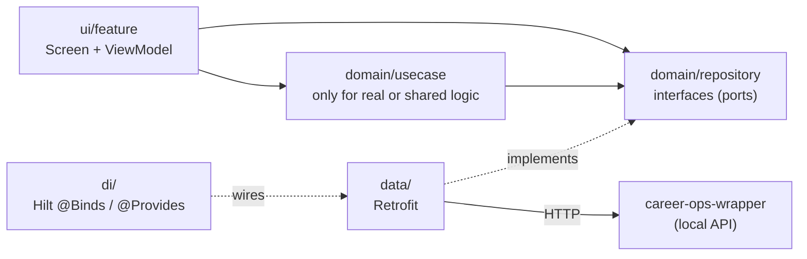
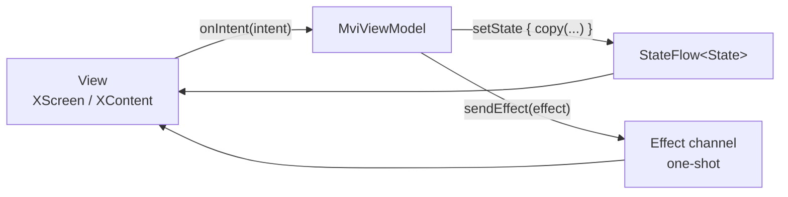
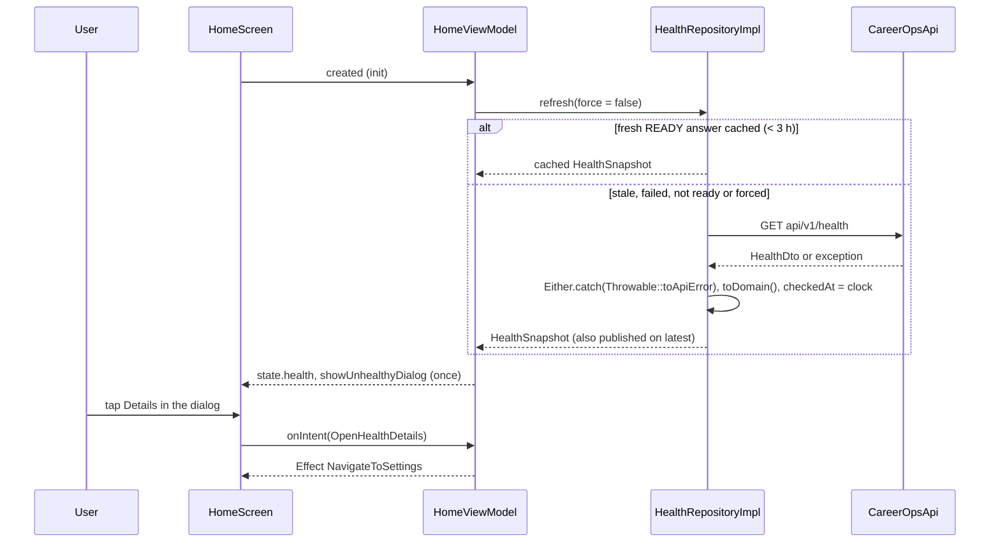
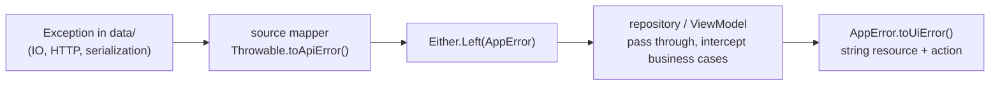

# System architecture

## Layers

- `ui/` depends on `domain/`. `domain/` depends on Kotlin only. `data/` depends on `domain/`.
- The domain defines ports (`HealthRepository`); `data/` implements them; `di/RepositoryModule`
  binds them. Replacing Retrofit or adding a cache touches `data/` plus one binding.
- The app never reads Career Ops workspace files. Everything goes through the wrapper API, which owns path containment,
  safe writes, command allowlists and pairing tokens (`../../docs/system-architecture.md`).
- It is one Gradle module on purpose ([ADR 1](decisions/0001-use-a-single-app-module.md)). The compiler cannot stop
  `ui/` from importing `data/`, so Konsist tests do (see [code standards](code-standards.md#automated-checks)).
- How many layers a feature really needs is a per-feature decision
  ([ADR 5](decisions/0005-scale-structure-with-feature-complexity.md)); the direction above is the only fixed part.

## Presentation patterns: which, when

Both share one idea: **unidirectional data flow with a single immutable state**.

|                 | MVVM-lite (default)                   | MVI                                                                                               |
|-----------------|---------------------------------------|---------------------------------------------------------------------------------------------------|
| State           | one `UiState` in a `StateFlow`        | one `State` in a `StateFlow`                                                                      |
| Input           | public functions on the ViewModel     | one `onIntent(Intent)` entry point                                                                |
| One-shot events | avoid; model as state if possible     | `Effect` channel + `CollectEffects`, for navigation only                                          |
| Pick it when    | simple screens, settings, small forms | interdependent state, async work with ordering, navigation events, you want inputs logged         |
| Example         | `ui/settings`                         | `ui/home`                                                                                         |

Start with MVVM-lite. Move a screen to MVI when you would add a third boolean flag, a `SharedFlow` for events, or you
hit ordering bugs between async calls. Never mix both in one screen. Why this split and not MVC, MVP or many flows per
screen: [ADR 2](decisions/0002-default-to-mvvm-lite-and-use-mvi-when-needed.md).

## Checking wrapper health

Home is the reference for async work, caching and one-shot effects.

`HealthRepositoryImpl` is an app singleton, so Home and Settings share one cache and one `latest` stream. Only a
READY answer is reused: failures and not-ready answers are checked again, so starting the wrapper or fixing the
workspace and tapping Check again (or reopening the app) recovers at once.

## Network

- `data/remote/CareerOpsApi.kt` declares the wrapper endpoints under `api/v1/`. Calls are `suspend` and throw on failure.
- `di/NetworkModule.kt` builds one `OkHttpClient` (with `PairingTokenInterceptor`, which adds `X-Career-Ops-Token` when
  a token exists; storage arrives with Epic 7) and one `Retrofit` using `ApiJson` (`ignoreUnknownKeys = true`).
- The base URL comes from the flavor: `BuildConfig.CAREER_OPS_DEFAULT_BASE_URL`. Only `dev` allows cleartext, and only to
  `10.0.2.2` and `localhost` (`app/src/dev/res/xml/network_security_config.xml`).
- DTOs in `data/remote/dto` mirror the wrapper's Zod contracts. Wire enums map unknown values to `UNKNOWN` instead of
  failing. `ApiContractCompatibilityTest` parses every example in `../career-ops-wrapper/contracts/examples`.

## Errors

Expected failures are values: repositories return `Either<AppError, T>` (Left is the error)
([ADR 10](decisions/0010-use-either-and-two-boundary-error-mapping.md)). Errors change shape at exactly two places:

- One mapper per data **source**, not per feature. It knows the SDK's exception types and nothing else does. Unknown
  exceptions go to `unexpected()`: rethrown in debug, logged and mapped to `AppError.Unknown` in release.
- `AppError` holds no `Throwable`, so states compare equal and exception text never reaches the UI.
- A wrapper error code (`ApiErrorCode`, mirrored from `ErrorCodeSchema` and checked by `ApiErrorCodeContractTest`) that
  is a normal branch of a flow becomes part of the success type; one a feature shows as an error becomes
  `AppError.Feature(<its sealed FeatureError>)`.
- `CancellationException` is always rethrown. Konsist fails the build if `ui/` or `domain/` catches exceptions.

## Dependency injection and lifetimes

Hilt wires everything. Interfaces live in `domain/`, implementations in `data/`, bindings in `di/RepositoryModule`;
`NetworkModule`, `TimeModule` and `CoroutinesModule` provide Retrofit, `Clock` and `DispatcherProvider`. Lifetimes are
listed in the [codebase summary](codebase-summary.md#lifetimes).

## Navigation

Navigation 3 with three top-level tabs (`navigation/TopLevelTab.kt`): Home, Inputs and Settings. Selecting a tab
replaces the back stack with `topLevelStack(tab)`, which always keeps `HomeRoute` at the bottom, so back from any tab
returns Home and `HomeViewModel` is never cleared while the app runs. Each feature exposes `XRoute : NavKey` and
`XScreen`; `navigation/NavGraph.kt` is the only place that knows every feature and passes navigation to screens as
callbacks. Two entry decorators (saved-state holder, then ViewModel store) scope `hiltViewModel()` to the back stack
entry. The bottom bar draws a blurred copy of the page behind it (kyant backdrop), so pages receive the scaffold's
`contentPadding` and scroll under it.

## Working with AI agents

Agents start from `AGENTS.md` and load skills (`.claude/skills/`) and path-scoped rules (`.claude/rules/`) on demand.
Decisions and their reasons live in `decisions/`, one file per decision.
