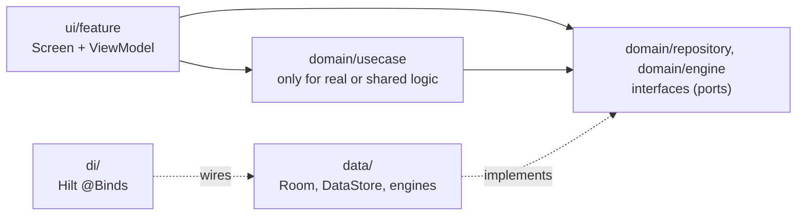
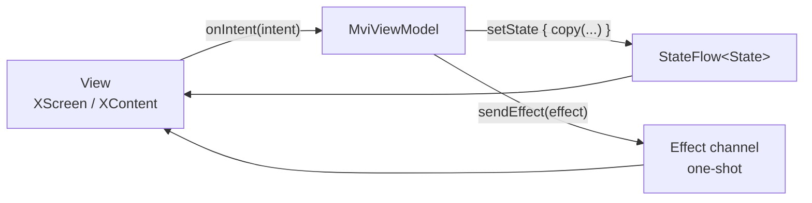
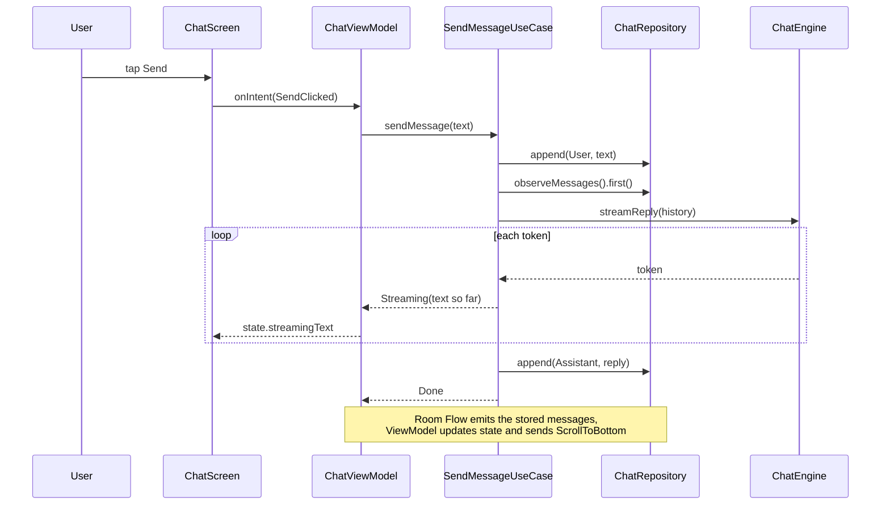
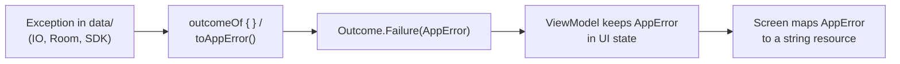

# System architecture

## Layers

- `ui/` depends on `domain/`. `domain/` depends on Kotlin only. `data/` depends on `domain/`.
- The domain defines ports (`ChatRepository`, `ChatEngine`); `data/` implements them; `di/RepositoryModule` binds them.
  Replacing Room, a REST API or an AI model touches `data/` plus one `@Binds`.
- It is one Gradle module on purpose ([ADR 1](decisions/0001-use-a-single-app-module.md)). The compiler cannot stop
  `ui/` from importing `data/`, so Konsist tests do (see [code standards](code-standards.md#automated-checks)).
- How many layers a feature really needs is a per-feature decision
  ([ADR 5](decisions/0005-scale-structure-with-feature-complexity.md)); the direction above is the only fixed part.

## Presentation patterns: which, when

Both share one idea: **unidirectional data flow with a single immutable state**.

|                 | MVVM-lite (default)                   | MVI                                                                                               |
|-----------------|---------------------------------------|---------------------------------------------------------------------------------------------------|
| State           | one `UiState` in a `StateFlow`        | one `State` in a `StateFlow`                                                                      |
| Input           | public functions on the ViewModel     | one `onIntent(Intent)` entry point                                                                |
| One-shot events | avoid; model as state if possible     | `Effect` channel + `CollectEffects`                                                               |
| Pick it when    | simple screens, settings, small forms | interdependent state, streaming or async work, navigation/snackbar events, you want inputs logged |
| Example         | `ui/settings`                         | `ui/chat`                                                                                         |

Start with MVVM-lite. Move a screen to MVI when you would add a third boolean flag, a `SharedFlow` for events, or you
hit ordering bugs between async calls. Never mix both in one screen. Why this split and not MVC, MVP or many flows per
screen: [ADR 2](decisions/0002-default-to-mvvm-lite-and-use-mvi-when-needed.md).

## Sending a chat message

The chat feature is the reference for streaming, persistence and one-shot effects.

## Errors

Expected failures are values, not exceptions ([ADR 3](decisions/0003-return-outcome-for-expected-failures.md)).
`CancellationException` is always rethrown.

## Dependency injection and lifetimes

Hilt wires everything. Interfaces live in `domain/`, implementations in `data/`, all `@Binds` in
`di/RepositoryModule`; `DatabaseModule` and `CoroutinesModule` provide Room and `DispatcherProvider`. Lifetimes are listed
in the [codebase summary](codebase-summary.md#lifetimes).

## Navigation

Navigation 3. Each feature exposes `XRoute : NavKey` and `XScreen`; `navigation/NavGraph.kt` is the only place that
knows every feature and passes navigation to screens as callbacks (`onOpenSettings`, `onBack`). Two entry decorators
(saved-state holder, then ViewModel store) scope `hiltViewModel()` to the back stack entry so it is cleared on pop.

## Plugging in AI (model or API)

`ChatEngine` is the seam: the domain asks for a `Flow<String>` of tokens and does not care where they come from.

| Engine                       | What changes                                                                                      |
|------------------------------|---------------------------------------------------------------------------------------------------|
| `EchoChatEngine` (current)   | nothing; works offline for demos and tests                                                        |
| Gemini via Firebase AI Logic | new `GeminiChatEngine` in `data/engine`, change one `@Binds`                                      |
| On-device model              | new `OnDeviceChatEngine` in `data/engine`, model download handled in `data/`, change one `@Binds` |

Keep prompt templates, safety settings and model names in `data/`, never in a ViewModel. Steps:
[module guides](module-guides.md#swap-the-ai-engine).

## Working with AI agents

Agents start from `AGENTS.md` and load skills (`.claude/skills/`) and path-scoped rules (`.claude/rules/`) on demand.
Decisions and their reasons live in `decisions/`, one file per decision.
