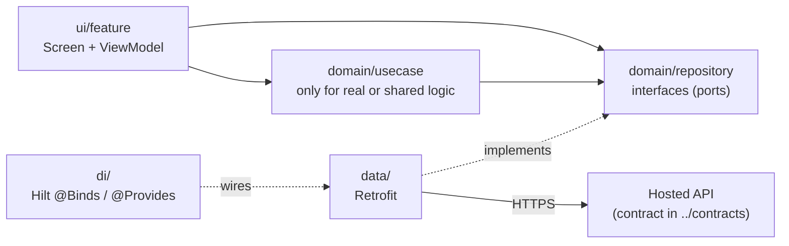
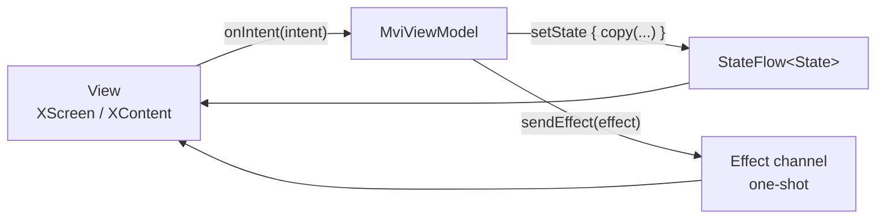
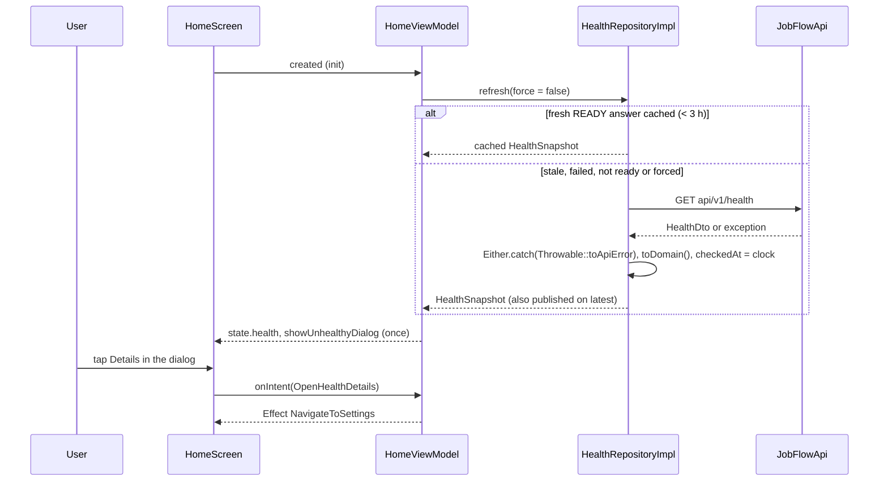
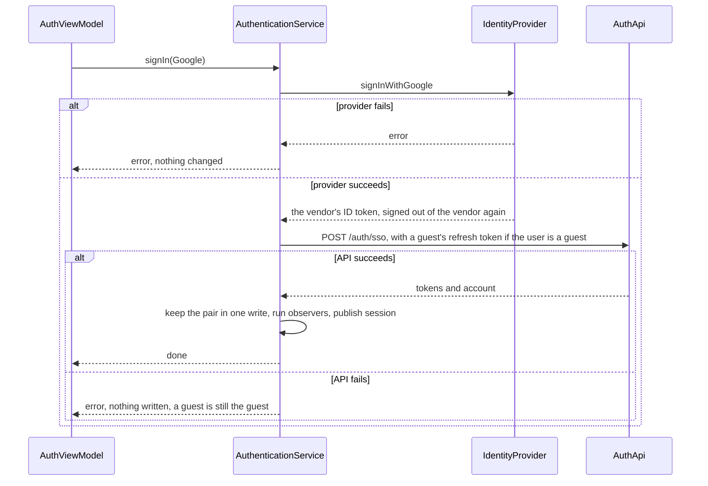
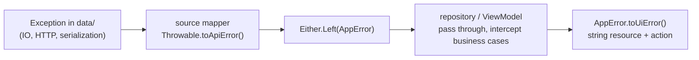

# System architecture

## Layers

- `ui/` depends on `domain/`. `domain/` depends on Kotlin only. `data/` depends on `domain/`.
- The domain defines ports (`HealthRepository`); `data/` implements them; `di/RepositoryModule`
  binds them. Replacing Retrofit or adding a cache touches `data/` plus one binding.
- Product data comes only from the hosted API; the backend owns authorization, user data and job sources
  (`../../docs/system-architecture.md`). Firebase Auth is the one other service: it says who the user is
  ([Authentication](#authentication)).
- It is one Gradle module on purpose ([ADR 1](decisions/0001-use-a-single-app-module.md)). The compiler cannot stop
  `ui/` from importing `data/`, so Konsist tests do (see [code standards](code-standards.md#automated-checks)).
- How many layers a feature really needs is a per-feature decision
  ([ADR 5](decisions/0005-scale-structure-with-feature-complexity.md)); the direction above is the only fixed part.

## Presentation patterns: which, when

Both share one idea: **unidirectional data flow with a single immutable state**.

|                 | MVVM-lite (default)                   | MVI                                                                                               |
|-----------------|---------------------------------------|---------------------------------------------------------------------------------------------------|
| State           | one `UiState` in a `StateFlow`        | one `State` in a `StateFlow`                                                                      |
| Input           | public functions on the ViewModel     | one `onIntent(Intent)` entry point                                                                |
| One-shot events | avoid; model as state if possible     | `Effect` channel + `CollectEffects`, for navigation only                                          |
| Pick it when    | simple screens, settings, small forms | interdependent state, async work with ordering, navigation events, you want inputs logged         |
| Example         | `ui/settings`                         | `ui/home`                                                                                         |

Start with MVVM-lite. Move a screen to MVI when you would add a third boolean flag, a `SharedFlow` for events, or you
hit ordering bugs between async calls. Never mix both in one screen. Why this split and not MVC, MVP or many flows per
screen: [ADR 2](decisions/0002-default-to-mvvm-lite-and-use-mvi-when-needed.md).

## Checking API health

Home is the reference for async work, caching and one-shot effects.

`HealthRepositoryImpl` is an app singleton, so Home and Settings share one cache and one `latest` stream. Only a
OK answer is reused: failures and degraded answers are checked again, so tapping Check again (or reopening the app)
recovers at once.

## Network

- `data/remote/JobFlowApi.kt` declares the endpoints under `api/v1/`. Calls are `suspend` and throw on failure. Health
  returns a `Response`, because `healthOrThrow` treats its 503 with a health body as an answer.
- `di/NetworkModule.kt` builds one `OkHttpClient` with the bearer token interceptor and authenticator (health needs no
  token) and one `Retrofit` using `ApiJson` (`ignoreUnknownKeys = true`).
- The base URL comes from the flavor: `BuildConfig.API_BASE_URL`. Only `dev` allows cleartext, and only to
  `10.0.2.2` and `localhost` (`app/src/dev/res/xml/network_security_config.xml`).
- DTOs in `data/remote/dto` mirror the hosted contract. Wire enums map unknown values to `UNKNOWN` instead of
  failing. `ApiContractCompatibilityTest` parses every example in `../contracts/examples`.

## Authentication

Firebase only proves who signed in; the backend issues the session and decides what the user may do. The app only
displays whether the user is a guest, it never authorizes with it. The reasons are in
[ADR 15](decisions/0015-sign-in-through-the-backend-and-keep-only-its-session.md), which replaces the guest and session parts of
[ADR 13](decisions/0013-keep-auth-self-contained-with-one-session-source.md).

| Piece | Job | Never |
|---|---|---|
| `ui/auth/AuthViewModel.kt` | MVI. One per screen, holding only that screen's error and sign-in in progress | Knows Firebase or the API |
| `ui/auth/GoogleCredentials.kt` | Shows Google's sheet, which needs an Activity, and returns an ID token | Holds session logic |
| `domain/auth` | `AuthenticationService`, `Session`, `SignInMethod`, `AuthError`, `SessionObserver` | Knows Firebase or Android |
| `data/auth/AuthenticationServiceImpl.kt` | The one source of the session and `isBusy`; runs commands one at a time on the app's scope; keeps a new session in one write; publishes it only after observers ran | Calls an SDK |
| `data/auth/SignInStrategies.kt` | One strategy per method that gets a session from the backend, and the best-effort logout call | Keeps or publishes a session |
| `data/auth/SessionStore.kt` | The backend's token pair, user id and expiry, in the auth DataStore | |
| `data/auth/SessionTokens.kt` | Refreshes the access token before it ends and after a 401, one refresh at a time; a 401 from refresh ends the session | Signs out for a network failure or a 5xx |
| `data/auth/IdentityProvider.kt` | The boundary with the identity vendor: Google's token in, the vendor's ID token out | Mentions Firebase |
| `data/auth/firebase/` | The only code that imports Firebase; it signs out of Firebase right after every sign-in | Holds product rules or a session |
| `data/auth/AuthApi.kt` | `POST /auth/guest`, `/auth/sso`, `/auth/refresh`, `/auth/logout` | |
| `data/auth/BearerToken.kt` | Adds the access token, and retries a 401 once with a refreshed one | |

- `Session` is `Unknown` (not read from the device yet), `SignedOut`, `Guest` or `Member`. It is known offline, so
  navigation reads it.
- A guest starts once per install (`GuestLedger`), through `POST /auth/guest`. After the install's guest only Google is left.
  Uninstalling resets it. This is a product rule, not abuse protection: the API's limits and Play Integrity stop scripts.
- A guest has no sign-out, because it would lose their data. Before a guest signs in with Google, the screen says their data
  moves to the account they pick.
- **A sign-in is all or nothing.** A new session replaces the old one in one write, only after the backend answered. If
  anything fails, nothing is written. `/auth/sso` is safe to repeat, also after a merge whose answer was lost.
- The access token is refreshed before a request when less than 60 seconds are left, counted from when it arrived, and once
  after a 401. Only a 401 from `/auth/refresh` ends a session. A network failure or a 5xx keeps it.
- The user pressing sign out calls `/auth/logout` as best effort, then forgets the session on the device. It works offline.

| Change | User id | Session | Observers run |
|---|---|---|---|
| A guest starts | New | `Guest` | Yes |
| A guest signs in with Google | The member's | `Member`, and the backend merges | Yes |
| Sign-out, or the backend ends the session | None | `SignedOut` | Yes |

## Errors

Expected failures are values: repositories return `Either<AppError, T>` (Left is the error)
([ADR 10](decisions/0010-use-either-and-two-boundary-error-mapping.md)). Errors change shape at exactly two places:

- One mapper per data **source**, not per feature. It knows the SDK's exception types and nothing else does. Unknown
  exceptions go to `unexpected()`: rethrown in debug, logged and mapped to `AppError.Unknown` in release.
- `AppError` holds no `Throwable`, so states compare equal and exception text never reaches the UI.
- An API error code (`ApiErrorCode`, mirrored from `contracts/error-codes.json` and checked by `ApiErrorCodeContractTest`) that
  is a normal branch of a flow becomes part of the success type.
- A feature with failures of its own has its own sealed error type and mappers instead of `AppError`
  ([ADR 14](decisions/0014-give-a-feature-its-own-error-type-when-it-has-its-own-failures.md)). Auth is the first.
- `CancellationException` is always rethrown. Konsist fails the build if `ui/` or `domain/` catches exceptions.

## Dependency injection and lifetimes

Hilt wires everything. Interfaces live in `domain/`, implementations in `data/`, bindings in `di/RepositoryModule`;
`NetworkModule`, `TimeModule` and `CoroutinesModule` provide Retrofit, `Clock` and `DispatcherProvider`. Lifetimes are
listed in the [codebase summary](codebase-summary.md#lifetimes).

## Navigation

Navigation 3 with three top-level tabs (`navigation/TopLevelTab.kt`): Home, Inputs and Settings. Selecting a tab
replaces the back stack with `topLevelStack(tab)`, which always keeps `HomeRoute` at the bottom, so back from any tab
returns Home and `HomeViewModel` is never cleared while the app runs. Each feature exposes `XRoute : NavKey` and
`XScreen`; `navigation/NavGraph.kt` is the only place that knows every feature and passes navigation to screens as
callbacks. Two entry decorators (saved-state holder, then ViewModel store) scope `hiltViewModel()` to the back stack
entry. The bottom bar draws a blurred copy of the page behind it (kyant backdrop), so pages receive the scaffold's
`contentPadding` and scroll under it.

## Working with AI agents

Agents start from `AGENTS.md` and load skills (`.claude/skills/`) and path-scoped rules (`.claude/rules/`) on demand.
Decisions and their reasons live in `decisions/`, one file per decision.
