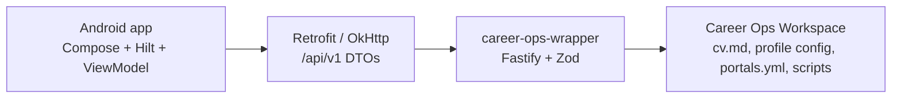
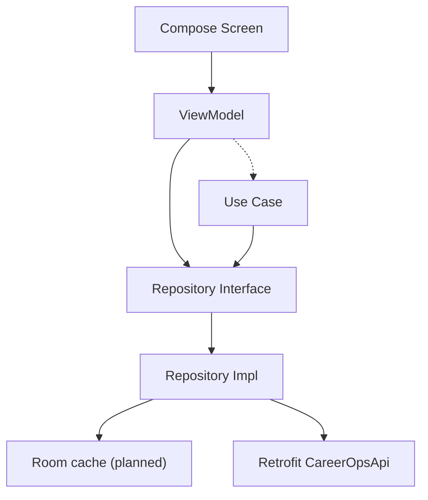
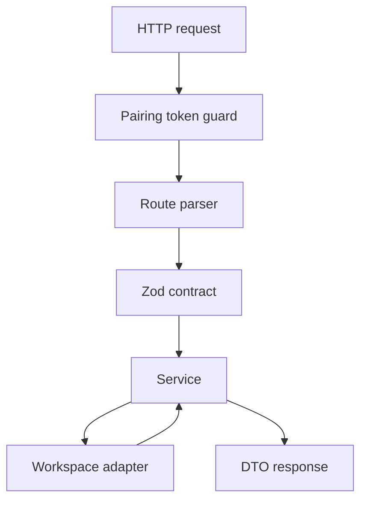
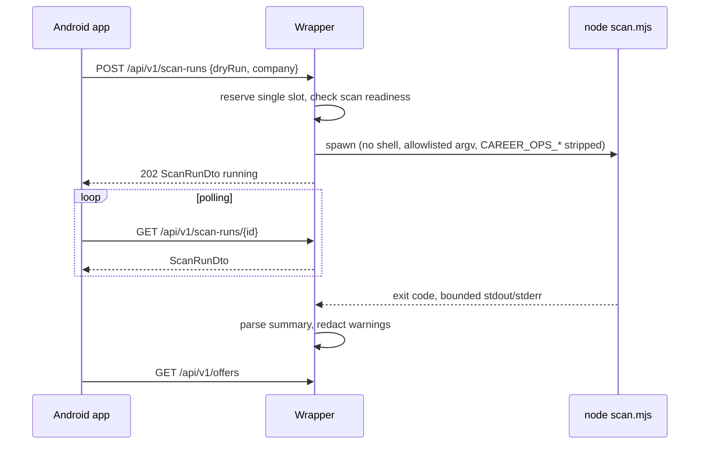

# System Architecture

## Overview

JobFlow is local-first. The Android app is the user interface. The wrapper API
is the only integration surface for Career Ops workspace files and scripts.



## Component Responsibilities

| Component | Owns |
| --- | --- |
| Android presentation | Screens, UI state, intents, effects, user feedback |
| Android domain | App models, repository contracts, use cases |
| Android data | Retrofit, DTO mapping, error mapping, repository implementations (Room cache planned) |
| Wrapper routes | HTTP endpoints, request parsing, response schema checks |
| Wrapper services | Use-case behavior for health, CV, profile, portals, readiness, scan runs, offer/report/artifact projection |
| Wrapper parsers | Pure parsing of Career Ops tracker, pipeline, scan history, reports, scan output |
| Wrapper workspace adapters | File reads/writes, bounded symlink-safe reads, YAML/Markdown translation, backups |
| Wrapper engine adapter | Spawns `scan.mjs` with allowlisted args, timeout, bounded output |
| Wrapper runs | In-memory scan run registry (one active run) |
| Wrapper security | Path containment, pairing token guard, redaction |
| Career Ops workspace | Source-of-truth files and local scripts |

## Android Data Flow



Rules:

- UI must not import data-layer DTOs/entities.
- Repositories translate transport/storage models into domain models.
- Room (when added) is a projection cache, not Career Ops source of truth.
- Errors cross layers as `Either<AppError, T>`; details in
  `android/docs/system-architecture.md`.

## Wrapper Request Flow



Rules:

- Public setup endpoints: `/api/v1/health`, `/docs`, `/openapi.json`.
- Protected endpoints require pairing token when wrapper binds to LAN/private
  host.
- Workspace writes go through safe adapters.
- Generic command execution endpoints are forbidden.
- Offers, reports, and artifacts are read-only projections; their IDs are
  opaque hashes or report numbers, matched against listings, never joined
  into paths.

## Scan Run Lifecycle



`scan.mjs` only finds job links and writes `data/pipeline.md` and
`data/scan-history.tsv`. Scores and reports come from AI evaluation on the
desktop; the wrapper never runs AI CLIs. Offers found from the phone show
`evaluationStatus: "notEvaluated"` until that evaluation runs.

## Runtime Configuration

Wrapper config order:

1. CLI flags
2. `.env`
3. safe defaults

Defaults:

```text
CAREER_OPS_HOST=127.0.0.1
CAREER_OPS_PORT=3000
CAREER_OPS_PAIRING_TOKEN=
```

Android dev flavor points to:

```text
http://10.0.2.2:3000
```

## API Surface

Current wrapper route families:

- Health and readiness.
- CV Markdown read/write.
- Profile config read/write.
- Portal config read/write.
- Scan readiness.
- Scan run start/status (`/scan-runs`).
- Offers projection (`/offers`).
- Reports (`/reports`) and artifacts (`/artifacts`, PDF download).
- API docs/OpenAPI.

## Key Architecture Decisions

- Wrapper over direct Android workspace access.
- Career Ops workspace as source of truth.
- Android Room as a projection cache (planned, Story 2.6).
- Fastify + Zod as API boundary.
- Polling is acceptable for MVP scan lifecycle.
- Local Pairing Token protects LAN/private wrapper use.
- Opaque backend IDs for offers (`offer_<hash>`), reports (`report_NNN`),
  artifacts (`artifact_<hash>`), and scan runs (`scan_<time>_<hex>`).
- Scan runs are kept in memory; a wrapper restart forgets them.

## Risk Areas

- Contract drift between wrapper DTOs and Android DTOs.
- Accidental raw path exposure.
- Cleartext dev networking leaking into prod.
- Workspace writes that fail to preserve unknown fields.
- Scan execution becoming generic command execution.
- Android cache diverging from Career Ops workspace without freshness labels.
