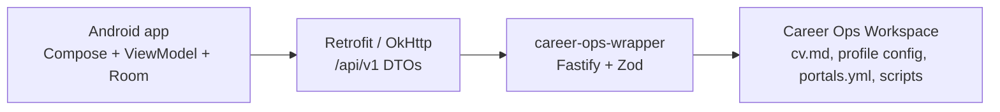
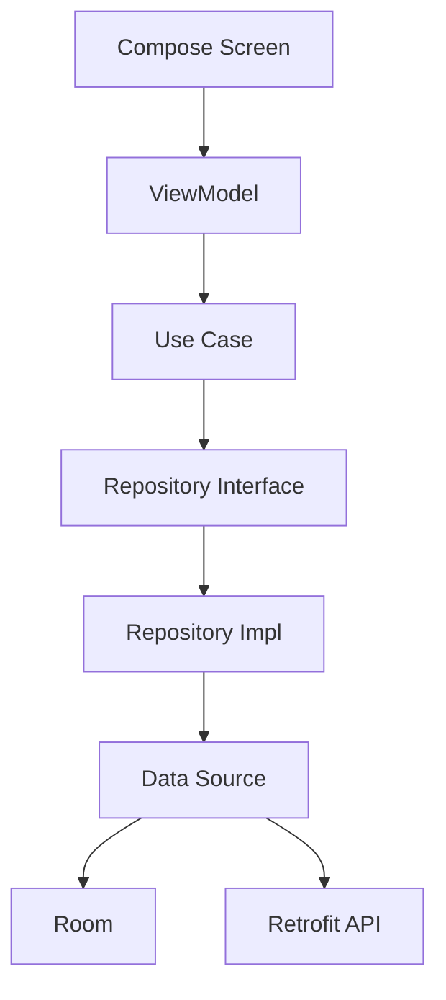
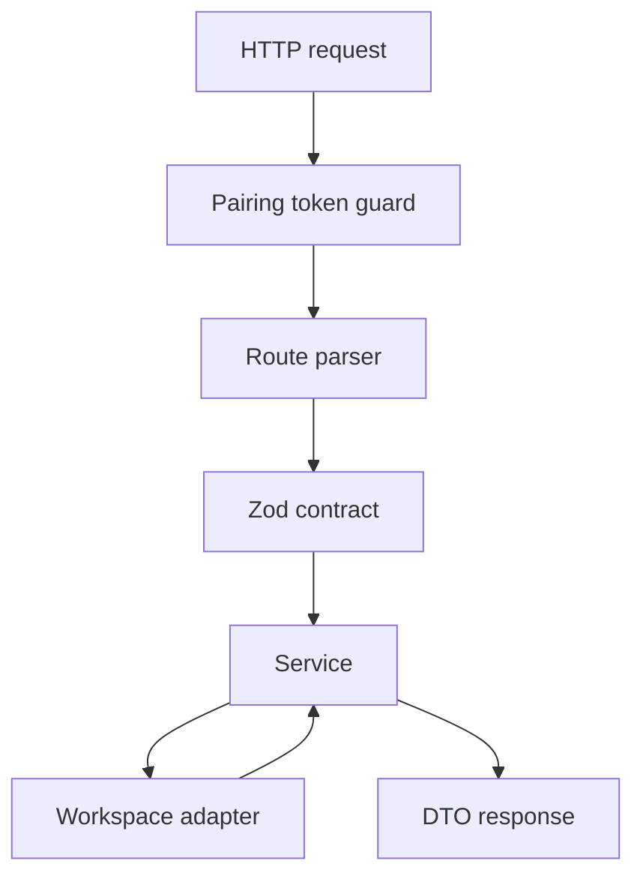

# System Architecture

## Overview

JobFlow is local-first. The Android app is the user interface. The wrapper API
is the only integration surface for Career Ops workspace files and scripts.



## Component Responsibilities

| Component | Owns |
| --- | --- |
| Android presentation | Screens, UI state, intents, effects, user feedback |
| Android domain | App models, repository contracts, use cases |
| Android data | Room, Retrofit, DTO mapping, repository implementations |
| Wrapper routes | HTTP endpoints, request parsing, response schema checks |
| Wrapper services | Use-case behavior for health, CV, profile, portals, readiness |
| Wrapper workspace adapters | File reads/writes, YAML/Markdown translation, backups |
| Wrapper security | Path containment, pairing token guard, redaction |
| Career Ops workspace | Source-of-truth files and local scripts |

## Android Data Flow



Rules:

- UI must not import data-layer DTOs/entities.
- Repositories translate transport/storage models into domain models.
- Room is local app state or projection cache, not Career Ops source of truth.

## Wrapper Request Flow



Rules:

- Public setup endpoints: `/api/v1/health`, `/docs`, `/openapi.json`.
- Protected endpoints require pairing token when wrapper binds to LAN/private
  host.
- Workspace writes go through safe adapters.
- Generic command execution endpoints are forbidden.

## Runtime Configuration

Wrapper config order:

1. CLI flags
2. `.env`
3. safe defaults

Defaults:

```text
CAREER_OPS_HOST=127.0.0.1
CAREER_OPS_PORT=3000
CAREER_OPS_PAIRING_TOKEN=
```

Android dev flavor points to:

```text
http://10.0.2.2:3000
```

## API Surface

Current wrapper route families:

- Health and readiness.
- CV Markdown read/write.
- Profile config read/write.
- Portal config read/write.
- Scan readiness.
- API docs/OpenAPI.

Planned route families:

- Scan run start/status.
- Offers projection.
- Reports and artifacts.

## Key Architecture Decisions

- Wrapper over direct Android workspace access.
- Career Ops workspace as source of truth.
- Android Room as app state/projection cache.
- Fastify + Zod as API boundary.
- Polling is acceptable for MVP scan lifecycle.
- Local Pairing Token protects LAN/private wrapper use.
- Opaque backend IDs should be used for future reports/artifacts/offers.

## Risk Areas

- Contract drift between wrapper DTOs and Android DTOs.
- Accidental raw path exposure.
- Cleartext dev networking leaking into prod.
- Workspace writes that fail to preserve unknown fields.
- Scan execution becoming generic command execution.
- Android cache diverging from Career Ops workspace without freshness labels.
